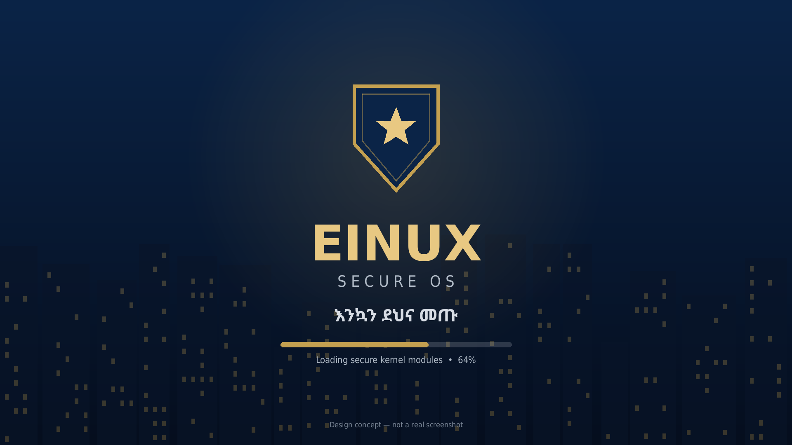
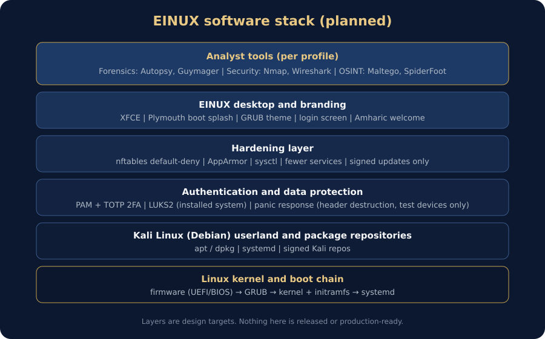
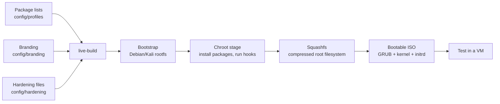
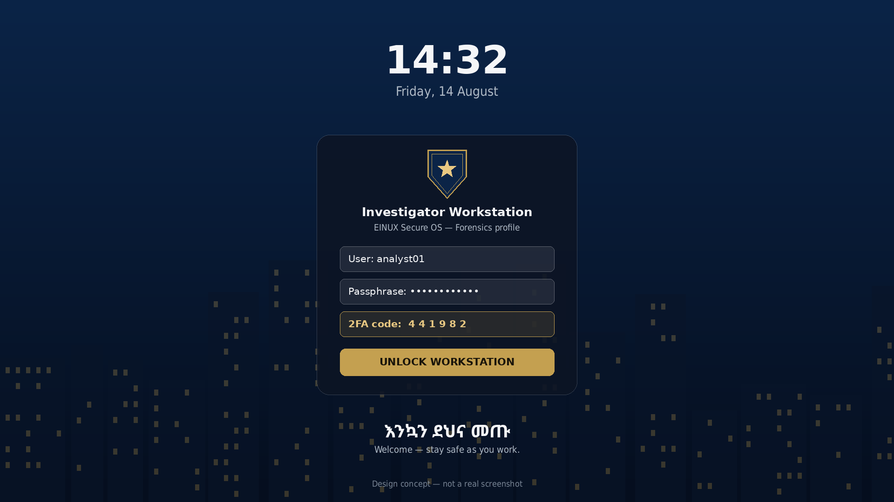
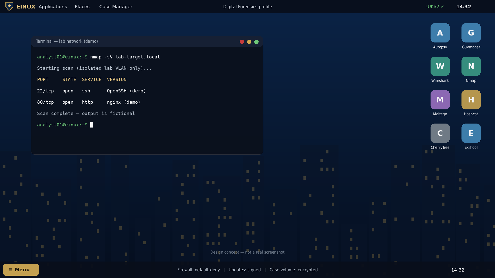
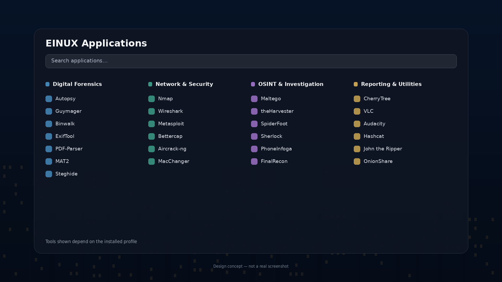
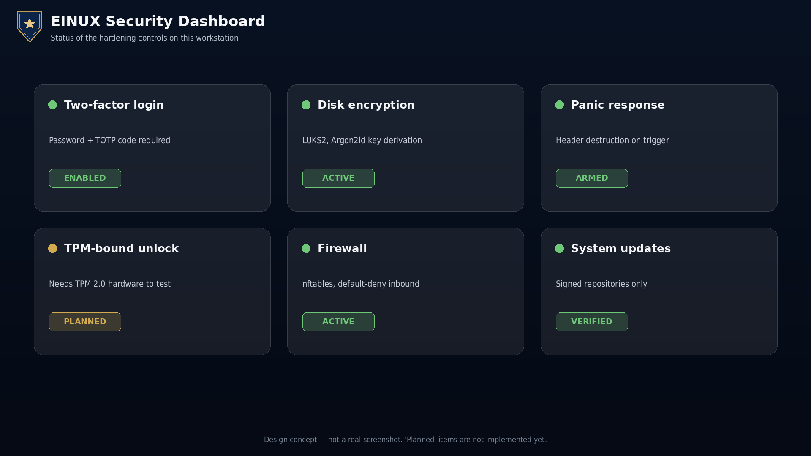
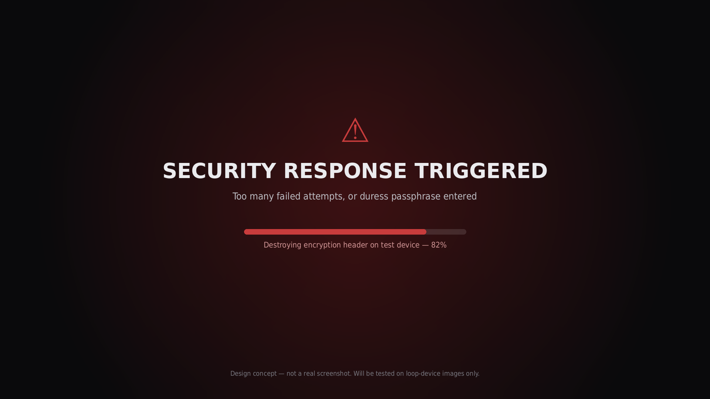

<div align="center">



# EINUX Secure OS

**A hardened, Kali-based Linux distribution for cyber security and digital forensics work, built from source with live-build.**


</div>

> **Project status: early development.** Nothing here is released or production-ready.
> The images below are **design mockups**, not screenshots. They show where the project is heading.

## Why this project exists

Stock security distributions ship hundreds of tools that most analysts never use, and nothing
protects the machine itself if it is lost or seized. EINUX aims to be a smaller, consistent,
hardened image with tools grouped by job, and it is also a hands-on study of how a Linux
distribution is built, from firmware and bootloader to the desktop.

## Goals

| Goal | Status |
|---|---|
| Reproducible ISO built with Kali's live-build | Planned |
| Role-based tool profiles (base, forensics, netsec) | Planned |
| EINUX branding: boot splash, GRUB, login, wallpaper | Planned |
| Hardening: nftables default-deny, AppArmor, sysctl | Planned |
| LUKS2 disk encryption and TOTP two-factor login (installed system) | Planned |
| Panic response (encryption-header destruction), tested on loop devices only | Planned |
| TPM-bound unlock, decoy OS | Stretch, not promised |

## Stack



### Build pipeline



## Tool profiles

| Profile | Purpose | Examples |
|---|---|---|
| **base** | Minimal secure system | Tor, nftables, AppArmor, cryptsetup, CherryTree |
| **forensics** | Evidence analysis and investigation | Autopsy, Guymager, Binwalk, ExifTool, Maltego, SpiderFoot |
| **netsec** | Network security testing in isolated labs | Nmap, Wireshark, Bettercap, Aircrack-ng, Metasploit |

Package names are verified against the Kali repositories as each profile is built.

## Interface concepts

> Design mockups made for this project. The interface is not implemented yet.

<table>
  <tr>
    <td width="50%"><br><sub><b>Login with two-factor authentication</b></sub></td>
    <td width="50%"><br><sub><b>Forensics desktop</b></sub></td>
  </tr>
  <tr>
    <td width="50%"><br><sub><b>Application launcher grouped by role</b></sub></td>
    <td width="50%"><br><sub><b>Security dashboard</b></sub></td>
  </tr>
  <tr>
    <td colspan="2" align="center"><br><sub><b>Panic response screen (test devices only)</b></sub></td>
  </tr>
</table>

## Security principles

- No custom cryptography: LUKS2, PAM modules and nftables are used as shipped.
- Destructive code is tested only against loop-device image files, never real disks.
- Offensive tools are meant for isolated lab networks and authorised work only.
- Only signed Kali/Debian repositories. No `curl | bash` installers.
- The full threat model is in [docs/SECURITY_DESIGN.md](docs/SECURITY_DESIGN.md).

## Roadmap

Each milestone is finished when it works **and** can be explained.

- [ ] M0 Lab: hypervisor, Kali build VM, snapshot
- [ ] M1 Boot by hand: debootstrap, chroot, boot in QEMU
- [ ] M2 Stock Kali ISO with live-build; inspect squashfs and initrd
- [ ] M3 Package profiles verified and building
- [ ] M4 Branding
- [ ] M5 Hardening
- [ ] M6 LUKS2 and 2FA on an installed system
- [ ] M7 Panic response (loop devices only)
- [ ] M8 Full test pass and documentation

Details: [docs/ROADMAP.md](docs/ROADMAP.md) · [docs/DECISIONS.md](docs/DECISIONS.md) · [docs/RISKS.md](docs/RISKS.md)

## Repository layout

```
build/      ISO build scripts
config/     package profiles, branding, hardening
tests/      test checklist
docs/       roadmap, risks, decisions, security design, images
```

## Building

Builds run inside a Kali or Debian VM, never on your main machine. Build instructions will
be added as milestone M2 is completed.

## Contributing

This is a learning project. Issues and suggestions are welcome, especially corrections to
security design. Please never include real case data, credentials or personal information.

## Licence and notices

Code and configuration are released under **GPL-3.0**.
The EINUX name, the shield mark and the interface mockups are original to this project.
The Ethiopian Federal Police name and emblem are **not** covered by this licence and are not
included in this repository.
Kali Linux is a trademark of OffSec. This project is independent and not affiliated with or endorsed by OffSec.

